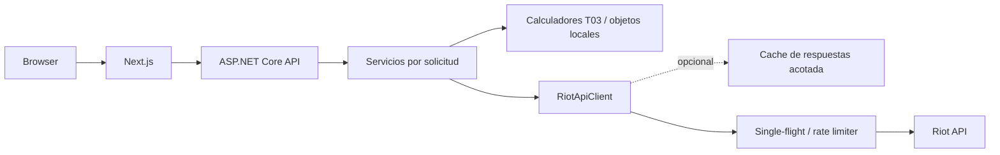

# Arquitectura actual — T03.5

La implementación del checkout es una API stateless. [El informe T03.5](T03_5_STATELESS_ARCHITECTURE.md) detalla contratos, pruebas, mediciones y límites. [El contexto archivado](archive/PROJECT_CONTEXT_THROUGH_T03.md) conserva la evolución anterior.

La búsqueda recupera cinco partidas y termina al devolverlas. El análisis recupera por sí mismo el objetivo y las ventanas históricas de sus participantes: cinco del owner, tres por cada otro jugador. Solo la unión de partidas elegibles de la solicitud alimenta estadísticas, encuentros, relaciones y familiaridad; nunca un agregado precalculado de otro usuario.

No hay DbContext, base de datos, Redis ni jobs registrados en la API. Los servicios antiguos de persistencia se compilan en un proyecto de regresiones separado y no son dependencias del artefacto API. El worker histórico no aparece en Compose.

La caché de respuestas Riot puede vaciarse, expirar, desactivarse o fallar sin alterar la capacidad funcional de los dos flujos. Single-flight y un limitador de solicitudes compartido por proceso reducen trabajo duplicado y respetan 429/Retry-After. Se limita el número de partidas, participantes, solicitudes, tamaño de cuerpos, memoria cacheada y tiempo de ejecución.

Solo la web se expone al host. Los datos de análisis viven en objetos C# locales y la respuesta HTTP; las credenciales permanecen únicamente en el runtime backend. PUUID es la identidad y los scores son heurísticos, no probabilidades ni verificaciones de premade.

T03.5 se desplegó en 8081 por instrucción posterior explícita del PO el 2026-10-18 (Panamá), desde `f14f328`/código `3afd6c6`. API y web fueron recreadas y verificadas saludables, sin cambiar secretos ni hacer merge. La evidencia operacional y sus límites están en `PROJECT_CONTEXT.md`; la refactorización inicial sí se entregó sin desplegar.
