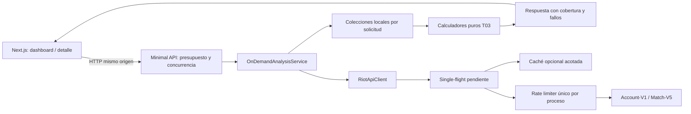

# T03.5 — API stateless bajo demanda

Fecha: 2026-10-18. Rama: `feature/t03-5-stateless-api`. Base comprobada: `feature/echo-product-focus`, `4d4580f`, con T01, T02 y T03. Este informe describe el código de la rama, no un despliegue. Los contenedores existentes no se reiniciaron.

## 1. Arquitectura anterior

La API usaba EF Core InMemory, repositorios, ingesta y relaciones incrementales compartidas por proceso. Las lecturas necesitaban un historial previamente sincronizado. T02 resolvió la incompatibilidad de transacciones SQL con InMemory y procesaba AnalysisJobs en la API mediante Channel y BackgroundService; el worker independiente no compartía ese almacén. T03 distinguió participaciones, PUUID únicos, recurrentes y cobertura.

El frontend coordinaba lookup, sync y lecturas posteriores; al abrir una partida sincronizaba participantes. El corpus podía crecer y mezclar información de consultas anteriores. La caché de T01 evitaba descargas, pero no eliminaba esa dependencia funcional de los repositorios.

## 2. Arquitectura nueva

`OnDemandAnalysisService` obtiene datos de Riot y construye colecciones locales. `RequestAnalysisCalculator` adapta esos objetos a los calculadores puros de T03. No registra DbContext, repositorios, jobs, scheduler ni Redis. Ninguna lectura necesita haber ejecutado otra operación.

EF/SQL/migraciones/Redis históricos permanecen en el árbol para trazabilidad y pruebas; se excluyen de la compilación de Infrastructure y se compilan en `apps/api/tests/LolAnalyzer.Legacy`. El worker de referencia depende de ese proyecto, pero no forma parte de Compose ni del grafo de dependencias de la API. No se afirma que el worker sea una alternativa operativa stateless. Una prueba inspecciona el `.deps.json` de la API y rechaza EF Core/StackExchange.Redis.

## 3. Diagrama



No hay almacén de resultados funcionales, base de datos ni cola de jobs en este flujo. Spectator/Summoner existentes conservan el endpoint independiente de partida activa.

## 4. Flujo 1: búsqueda

`GET /api/v1/players/by-riot-id/{gameName}/{tagLine}/analysis?platformRegion=LA1`:

1. Resolver cuenta por Riot ID, sin exponer la clave al navegador.
2. Pedir cinco Match IDs; deduplicarlos y descargar los detalles con concurrencia limitada.
3. Devolver identidad, partidas, KDA, campeón, resultado, fecha, duración, resumen, encuentros y cobertura.

No crea jobs ni conserva historial. Con caché vacía y cinco IDs únicos requiere siete llamadas externas: cuenta + lista + cinco detalles. Menos partidas disponibles se representa como información limitada, no se inventan filas. Fallos de detalles permiten una respuesta parcial. Si falla la identidad/lista imprescindible, se devuelve error controlado.

Paginación adicional: `GET /api/v1/players/{puuid}/recent-matches?start=5&count=5&platformRegion=LA1`. El contador de esa página representa partidas recuperadas hasta ese offset, no el total de partidas que Riot conserva. El dashboard mantiene su resumen inicial separado de las páginas adicionales.

## 5. Flujo 2: partida seleccionada

`POST /api/v1/matches/{matchId}/analyze` recibe `{ "ownerPuuid": "...", "platformRegion": "LA1" }`.

1. Obtener objetivo y validar al owner por PUUID, sin Account-V1/Summoner-V4 adicionales.
2. Extraer participantes identificables, máximo diez.
3. Solicitar hasta seis IDs del owner y cuatro por cada otro participante: los presupuestos funcionales siguen siendo **cinco y tres**. El ID adicional compensa la exclusión del objetivo.
4. Usar `endTime` en segundos con el inicio del objetivo. Excluir objetivo, IDs vacíos y duplicados; retener cinco/tres IDs por plan.
5. Descargar la unión de IDs, una vez por ID; comprobar que cada partida terminó antes o al inicio del objetivo y que contiene al participante correspondiente.
6. Conservar las asociaciones por participante, calcular sobre la unión elegible local y devolver detalle, owner, resumen, encuentros, relaciones, familiaridad, posibles premades y cobertura.

Para diez participantes hay como máximo 32 históricos distintos seleccionados: 5 + 9×3. En frío son como máximo 43 llamadas externas de este flujo: objetivo + diez listas + 32 detalles, antes de reintentos. El solapamiento reduce detalles; no se sustituye la ventana de cada jugador por 32 partidas arbitrarias.

### Temporalidad y limitación explícita

La referencia oficial [Match-V5](https://developer.riotgames.com/api-details/match-v5) declara `endTime` como timestamp epoch en segundos y `count` entre 0 y 100. Los [routing values oficiales](https://developer.riotgames.com/docs/lol#routing-values) orientan el host regional. Se comprobaron estos parámetros en la documentación pública, sin llamar a endpoints protegidos ni consumir cuota.

El filtro local por finalización es una segunda defensa: partidas posteriores o solapadas con el inicio del objetivo nunca aportan evidencia. Si Riot devuelve datos inesperados, menos elegibles o faltan fechas, se marca cobertura limitada. No se pagina ilimitadamente para rellenar ventanas tras errores o anomalías; la partida adicional compensa el objetivo, no garantiza recuperar cinco/tres en todos los casos.

## 6. Modelo de procesamiento y estadísticas

Los algoritmos existentes de encuentros, relaciones, puntuación, confianza y grupos se reutilizan, sin repositorios. Se generan IDs deterministas internos desde PUUID/Match ID para adaptar sus modelos; no identifican cuentas por nickname.

- Partidas: únicas por Match ID.
- Participaciones: apariciones por (Match ID, PUUID), excluyendo owner.
- Jugadores únicos: PUUID distintos, excluyendo owner.
- Recurrentes: PUUID presentes en al menos dos partidas del conjunto correspondiente.
- Encuentros: aliados/rivales, victorias/derrotas y primera/última fecha sobre partidas únicas.
- Familiaridad: otros participantes del lobby con evidencia anterior; máximo habitual nueve, no el total de personas del corpus.
- Premades: inferencias prudentes; evidencia como rivales descarta la señal y fechas aliadas distintas pueden elevarla, nunca verificarla.

En el análisis de lobby el conjunto es la unión de los históricos elegibles obtenidos para esa solicitud. Si el owner aparece también en una partida recuperada para otro participante, esa evidencia pertenece a la misma solicitud y puede ampliar su resumen; no amplía la ventana solicitada al owner ni usa datos de otra operación. El objetivo se muestra pero nunca cuenta como evidencia.

Los resultados se ordenan determinísticamente. Se distinguen `complete`, `partial`, `insufficient`, `error`, con filas de cobertura por PUUID y códigos seguros de fallo. La familiaridad de compatibilidad también transporta `PartialHistory`, `InsufficientHistory` o `AnalysisError`; un fallo nunca certifica cero conocidos.

## 7. Caché

Solo almacena respuestas Riot opcionales: listas 2 minutos, detalles 60 minutos, identidades 30 minutos. Las claves incluyen routing; las listas históricas incluyen fecha/cantidad. Las respuestas de partidas finalizadas admiten TTL mayor por su estabilidad. No se cachean resultados de análisis; el antiguo TTL de 15 minutos queda como configuración heredada sin uso funcional.

`Cache:Enabled=false` desactiva almacenamiento sin impedir los flujos. Un fallo de caché se degrada a consulta directa. Single-flight comparte exclusivamente tareas en curso; al terminar se elimina la referencia. La cancelación de un consumidor no cancela al resto; al cancelar todos se cancela upstream.

## 8. Concurrencia y límites

- API: ocho solicitudes concurrentes, cola de dieciséis por defecto; ambos configurables y validados.
- Operación: tres tareas simultáneas por defecto, configurable 1–5.
- Riot: un limitador singleton compartido para todas las instancias del cliente dentro del proceso; conserva Retry-After, backoff y reintentos acotados de T01. El límite compartido conservador no multiplica capacidad por región.
- Presupuesto HTTP: 180 segundos configurable 5–300; Next proxy: 210 segundos. Petición Riot: diez segundos por defecto; el timeout incluye lectura de cuerpo.
- CancellationToken atraviesa llamadas, espera del limitador, single-flight y procesamiento paralelo. Presupuesto agotado produce 504; desconexión cancela trabajo sin intentar devolver una respuesta normal.

## 9. Memoria

Máximo 4096 entradas de caché y presupuesto estimado de 64 MiB, configurables. La estimación conservadora incluye serialización y overhead; **no es un límite de RSS del proceso**. Expiración y limpieza oportunistas en accesos/escrituras, sin un índice de tags ilimitado. Entradas expiradas no se sirven; pueden conservar referencias hasta el siguiente acceso/escritura, siempre dentro de los límites.

Cada respuesta Riot se limita a 1 MiB; las peticiones de la API a 64 KiB. Las colecciones de trabajo tienen límites derivados de cinco/tres/diez; se descarta RawJson en las copias locales de históricos. Las referencias por operación son recolectables después de responder; solo DTOs de Riot en caché pueden sobrevivir con TTL. No hay diccionario global que sustituya a EF como base simulada.

## 10. AnalysisJobs

Inventario: los endpoints estaban definidos en Program y usados por pruebas anteriores; el dashboard y el detalle no hacían polling ni creaban jobs. El worker no estaba en Compose. Se retiran del runtime Channel, BackgroundService, almacenamiento y ciclo de estados; el código histórico se conserva para trazabilidad/regresión.

El benchmark simulado de la sección 13 no demuestra latencias reales bajo cuota Riot. Por tanto la eliminación se acepta para el MVP bajo demanda con presupuesto explícito, no como garantía de finalizar siempre antes de 180 segundos. Un 429 prolongado puede agotar ese presupuesto; el frontend presenta error y permite reintentar aprovechando caché opcional. No se introduce una cola oculta ni se continúa el trabajo tras cancelar todos los consumidores. Antes de alojar detrás de otro proxy debe verificarse su timeout real. No existe despliegue cloud verificable para certificar esos límites.

Consecuencias: sin polling, progreso persistido, reanudación, afinidad de instancia ni recuperación de jobs. Si carga real autorizada demuestra duraciones incompatibles, decidir con el PO entre una ventana operativa menor y un protocolo de respuesta incremental cancelable; no reintroducir almacenamiento durable implícitamente.

## 11. Contratos y consumidores

| Endpoint | Estado en T03.5 | Consumidor |
|---|---|---|
| GET by-riot-id/.../analysis | Nuevo; respuesta autocontenida | Dashboard |
| GET players/{puuid}/recent-matches | Nuevo; páginas de cinco | Dashboard |
| POST matches/{matchId}/analyze | Nuevo; respuesta autocontenida | Detalle |
| GET by-riot-id/... | Conservado; identidad desde Riot | Compatibilidad |
| GET matches/{matchId} | Conservado; con owner analiza independientemente | Compatibilidad |
| GET summary / known-players / encounters / matches | Conservados; consultan ventana de cinco sin estado previo | Compatibilidad |
| GET active-game | Conservado; integración existente | Dashboard |
| Jobs / sync / refresh-schedule / relationships / network | 410 explícito | Fuera de los dos flujos; utilidades antiguas no invocadas |

Frontend y backend cambian juntos; el dashboard deja de orquestar sincronizaciones y el detalle usa una sola solicitud. El componente de red ya no estaba montado y no se amplía. Los clientes externos que consuman endpoints retirados deben migrar: la retirada es un cambio deliberado y no compatibilidad transparente. Los aliases antiguos de resumen usan plataforma configurada; para routing explícito deben usarse los contratos nuevos.

## 12. Pruebas

Validación final local en ARM64 (`aarch64`), SDK .NET 10 y Node/Next existentes. Todas las pruebas utilizan fixtures/HTTP simulado; no se consume cuota real de Riot. Las pruebas de regresión EF históricas se ejecutan solo en el proyecto Legacy.

| Comando / verificación | Resultado |
|---|---|
| `dotnet restore LolAnalyzer.slnx` | Correcto |
| `dotnet build LolAnalyzer.slnx --configuration Release --no-restore` | Correcto; cero errores y cero advertencias; incluye worker de referencia |
| `dotnet test LolAnalyzer.slnx --configuration Release --no-build` | 94 unitarias y 15 de integración aprobadas |
| `dotnet format LolAnalyzer.slnx --verify-no-changes --no-restore` | Correcto |
| `npm run lint`, `npm run type-check` | Correctos |
| `npm test` | 16 pruebas aprobadas |
| `npm run build` | Correcto |
| `docker compose -p t035-validation config --quiet` | Correcto; sin imprimir configuración sensible |
| `docker compose -p t035-validation build api web` | Ambas imágenes construidas; no se iniciaron servicios |
| Readiness mediante TestServer | 200 en API nueva con Riot simulado |
| Contenedores activos anteriores | API/web sanos; IDs y timestamps de arranque conservados |

La prueba opt-in de benchmark no mide en la suite ordinaria; se ejecuta además explícitamente con su variable habilitada (sección 13). Una validación intermedia detectó que el test de timeout no sustituía las opciones capturadas al inicio; se corrigió la resolución de opciones por solicitud y se verificó un 504 controlado con presupuesto de cinco segundos. No quedan fallos conocidos en estas validaciones. No se ha validado ejecución nativa AMD64 ni tráfico de producción.

Publicación: commit de código `3afd6c611cabd1ccc0d42333cf6a09e4f36c9e34`, [PR #83 hacia main](https://github.com/D0kker/improved-train/pull/83). La rama conserva los ancestros T01/T02/T03 de la referencia que main aún no contiene. La evidencia de publicación se registra en un commit documental posterior. CI remoto debe revisarse en el PR; sus resultados no se sustituyen por las comprobaciones locales descritas aquí. No se realizó merge ni despliegue.

Cobertura añadida: búsqueda con cinco/menos disponibles, análisis directo frío con diez participantes, presupuestos cinco/tres, 32 históricos sin solapamiento, objetivo/futuro excluidos, deduplicación, dos análisis independientes/determinismo, caché fría/caliente/expirada/desactivada/averiada, single-flight concurrente y cancelación, parcialidad, 429/Retry-After, límites de caché/cuerpo, routing y presupuesto HTTP.

## 13. Benchmark reproducible

Prueba opt-in `StatelessBenchmarkTests.CompareLegacyT03AndStatelessPipelinesWithSimulatedRiot`; activar `RUN_STATELESS_BENCHMARK=1`. Usa el pipeline T03 real con EF InMemory frente al nuevo servicio, caché real y Riot simulado con retardo de tres milisegundos, diez participantes y cinco históricos compartidos. Doce muestras por escenario/temperatura después de un calentamiento no medido. No simula límites reales de Riot ni tráfico de producción.

La variante fría de selección anterior incluye búsqueda/bootstrap porque el pipeline T03 no podía analizar directamente una base vacía. La nueva no lo necesita. La variante caliente conserva caché y estado anterior según su arquitectura. Se reutilizan calculadores/métricas con ciclos de vida equivalentes para evitar penalizar artificialmente la baseline.

Asignaciones: delta de `GC.GetTotalAllocatedBytes`, no memoria retenida por solicitud. CPU: delta de CPU del proceso de pruebas, no utilización porcentual. p95 con doce muestras aproxima el extremo alto de esta muestra pequeña, no un SLO. Las llamadas son al cliente simulado subyacente, no a Riot real.

Ejecución final Release sin builds simultáneos: una prueba de benchmark aprobada, 96 mediciones más ocho calentamientos. Host ARM64, runtime de pruebas .NET 10.0.13. El servicio publicado anterior permaneció activo; no se afirma aislamiento físico exclusivo del host.

| Flujo / caché | p50 anterior → nuevo (ms) | p95 anterior → nuevo (ms) | Llamadas simuladas anterior → nuevo | Hits anterior → nuevo |
|---|---:|---:|---:|---:|
| Búsqueda fría | 154.02 → 17.74 | 226.36 → 19.14 | 7 → 7 | 0 → 0 |
| Búsqueda caliente | 13.94 → 1.19 | 21.01 → 1.53 | 0 → 0 | 1 → 7 |
| Selección fría | 326.47 → 46.33 | 429.12 → 50.84 | 18 → 16 | 0 → 0 |
| Selección caliente | 93.23 → 20.24 | 178.78 → 22.20 | 0 → 0 | 10 → 16 |

| Flujo / caché | CPU media anterior → nueva (ms) | Asignaciones medias anteriores → nuevas (bytes) |
|---|---:|---:|
| Búsqueda fría | 181.96 → 8.57 | 2,300,059 → 86,286 |
| Búsqueda caliente | 18.50 → 2.24 | 568,716 → 42,299 |
| Selección fría | 555.10 → 64.85 | 9,077,487 → 736,406 |
| Selección caliente | 240.65 → 34.81 | 6,428,263 → 663,156 |

Interpretación limitada a este fixture: ambos pipelines conservan deduplicación T01 y recuperan cinco históricos únicos al analizar, sin contar el objetivo. Las dos llamadas menos de selección fría eliminan cuenta/lista de bootstrap, no una supuesta ausencia de deduplicación anterior. En caliente ambos evitan todas las llamadas externas; el número de hits difiere porque antes también se reutilizaban repositorios, por lo que más hits no significa por sí mismo una mejora. No se observaron errores en estas mediciones exitosas. Los tiempos no incluyen transporte HTTP frontend/API, assets ni la consulta opcional de partida activa.

La concurrencia se valida por separado con cuatro análisis simultáneos, igualdad de resultados y una descarga por ID, además de las pruebas del limitador Riot. No se midieron p50/p95 bajo carga concurrente sostenida ni memoria retenida/RSS por solicitud; quedan como límites de esta evidencia.

Reproducción (SDK .NET instalado y dependencias restauradas):

```bash
RUN_STATELESS_BENCHMARK=1 dotnet test apps/api/tests/LolAnalyzer.UnitTests/LolAnalyzer.UnitTests.csproj --configuration Release --no-build --filter FullyQualifiedName~StatelessBenchmarkTests --logger 'console;verbosity=detailed'
```

El test imprime el JSON de las ocho series con sus contadores. No contiene datos reales de jugadores ni credenciales.

## 14. Riesgos

1. Cuota Riot agregada entre procesos/instancias sin coordinación distribuida; stateless no equivale a cuota infinita. Validar carga antes de escalar horizontalmente.
2. Los benchmarks simulados no predicen segundos/minutos bajo throttling; 504 y reintento son degradación explícita, no conclusión completa.
3. Cambios de contratos retirados requieren migrar consumidores ajenos al frontend revisado.
4. Ventanas pequeñas pueden no contener evidencia; ausencia de coincidencias no prueba ausencia de premade.
5. La estimación de caché limita una estructura, no el heap/RSS total; observar memoria con carga autorizada.

## 15. Limitaciones y próximos pasos no implementados

Sin persistencia histórica, autenticación, cloud, pagos, rediseño ni almacenamiento distribuido. No hay medición real de producción ni prueba de carga contra Riot. La caché vacía funciona pero aumenta llamadas/latencia; reiniciar pierde solo optimizaciones. No se pueden reanudar jobs retirados. No se corrigen endpoints de funcionalidades fuera de los dos flujos para simular un corpus global.

Pendiente tras revisión: aprobar contratos, validar timeout del entorno de hosting y cuotas agregadas, observar memoria bajo carga real autorizada y decidir cualquier despliegue por separado. No hacer merge automático ni desplegar como parte de T03.5.

### Archivos afectados por responsabilidad

- Runtime y contratos: `apps/api/src/LolAnalyzer.Api/{Program.cs,AnalyzeMatchRequest.cs,AnalysisLog.cs,appsettings.json}`; `apps/api/src/LolAnalyzer.Application/Stateless/{AnalysisContracts.cs,OnDemandAnalysisService.cs,RequestAnalysisCalculator.cs}`.
- Riot y recursos: `apps/api/src/LolAnalyzer.Application/{Riot/IRiotApiClient.cs,Riot/RiotRouting.cs,Caching/CacheOptions.cs}`; `apps/api/src/LolAnalyzer.Infrastructure/{Riot/RiotApiClient.cs,Riot/RiotResponseCache.cs,Caching/MemoryCacheService.cs}`.
- Separación legacy: `LolAnalyzer.slnx`, los csproj de Infrastructure/Legacy/UnitTests/IntegrationTests/worker, `infrastructure/docker/worker.Dockerfile`, `workers/ingestion-worker/WorkerProcess.cs`; `AnalysisJobRepository.cs` solo recibe formato requerido por la validación.
- Pruebas: nuevos `StatelessAnalysisTests.cs`, `StatelessBenchmarkTests.cs`, `StatelessFixture.cs`, `StatelessEndpointTests.cs`; ampliación de `RiotApiClientTests.cs`. Se sustituye `PlayerLookupEndpointTests.cs`, dependiente de repositorios simulados, por integración del runtime stateless.
- Frontend: `apps/web/src/{api.ts,echo.ts}`, dashboard de player, detalle/página de match, `next.config.ts`, `tests/frontend.test.ts`.
- Operación/documentación: `docker-compose.yml`, README, especificación con aviso histórico, contexto/arquitectura/decisiones/TODO, auditoría T03 marcada histórica y contexto anterior archivado. Ningún archivo de secretos se modifica.
