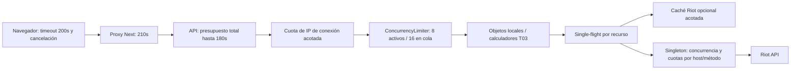

# T03.6 — Protección de recursos, concurrencia y resiliencia

Fecha: 2026-10-18 (Panamá). Base real: `41ac5ee` en `feature/t03-5-stateless-api`, con PR #83 abierto hacia main. Main seguía en `1c11fe3` y no contenía T03.5; la integración de T03.6 debe apuntar a la rama T03.5, no a main. No desplegar ni reiniciar servicios en esta tarea.

## 1. Arquitectura revisada

API stateless y calculadores puros conservados. Búsqueda inicial de cinco partidas; análisis independiente de cinco del owner y tres por otro participante, excluyendo objetivo y futuro. No se reactivan EF, jobs, persistencia ni endpoints retirados.

La skill del proyecto orientó continuidad, protección de secretos y verificaciones. Su referencia histórica a PostgreSQL no es aplicable: prevalecen la petición actual y D-042 stateless.

## 2. Riesgos encontrados y alcance de la corrección

| Hallazgo T03.5 | Corrección T03.6 |
|---|---|
| FIFO acotada pero sin espera de cola independiente | Mismo `ConcurrencyLimiter` de .NET, encapsulado en una única admisión con deadline de cola |
| Sin cuota por cliente y particiones potencialmente ilimitadas al añadirla | Token bucket por conexión con tabla limitada; overflow falla cerrado |
| Singleton Riot solo limitaba paralelismo y reaccionaba al 429 | Ventanas preventivas configurables y observación de cuotas app/método |
| Cooldown publicado después de liberar permiso | Publicación antes de liberar el lease; evita ventana de carrera |
| Cache miss leído antes de completar otro flight podía iniciar descarga tardía redundante | Segunda comprobación de caché al iniciar un flight nuevo; prueba intercalada determinista |
| Estimación de caché creaba un array UTF-8 completo adicional | Contador de bytes mediante Stream; no se materializa ese array explícito |
| Cancelación incompleta de acciones manuales/paginación | Vida de solicitudes ligada a componente y supersesión; timeout cancelable, sin retry automático |
| Timeout API configurable hasta 300s frente a proxy210s | Validación API 5–180s; navegador200s y proxy210s |
| Métricas sin colas, rechazos, memoria ni cancelaciones | Extensión de `OperationalMetrics`, sin plataforma de observabilidad nueva |

No se sustituyen los calculadores ni se paralelizan cálculos pequeños. No se agregan dependencias de producción.

La inspección de solo lectura del runtime T03.5 confirmó que sus overrides coinciden con los defaults reportados: API8/cola16, concurrencia operación3 y Riot3, presupuesto180s/HttpClient10s, caché4096/67108864bytes. También se verificaron en código los límites1MiB/64KiB y proxy210s. Esta auditoría no cambió esos contenedores.

## 3. RAM: cotas y significado de las mediciones

1. **Transitoria por solicitud:** como máximo diez participantes, 32 históricos únicos seleccionados y el objetivo, más parsing/serialización y las estructuras derivadas. El gate limita las operaciones admitidas y la cola no descarga históricos mientras espera.
2. **Retenida en caché:** hasta 4096 entradas y 64 MiB **estimados**, no bytes exactos del heap. TTL: identidades30min, listas2min, detalles60min. Expulsión de la primera entrada insertada al alcanzar entradas/bytes; no se anuncia LRU.
3. **Base .NET:** runtime, JIT, pools, metadata, framework, buffers y ensamblados. No está cubierta por el presupuesto de caché.
4. **Asignada acumulada:** `GC.GetTotalAllocatedBytes`, útil para comparar trabajo del GC; no representa RAM retenida ni RSS.
5. **Retenida tras GC:** heap administrado y working set medidos después de GC completo únicamente en las pruebas opt-in. El working set puede no bajar aunque objetos sean recolectables.

El byte counter de caché conserva la estimación conservadora previa (overhead + longitud serializada×4), pero evita el array de salida completo explícito. Sigue habiendo buffers de serialización; no es zero-allocation ni un límite duro de RSS. La expiración es oportunista: las entradas vencidas no se sirven y pueden mantener referencias hasta el siguiente acceso/escritura, siempre dentro de las cotas.

Single-flight almacena únicamente tareas pendientes, retiradas al completar/fallar/cancelar todos los consumidores. La expulsión de caché no elimina flights ni duplica descargas pendientes. Una prueba con WeakReference comprueba que el resultado funcional es recolectable manteniendo vivos servicio/caché; no basta con mirar asignaciones acumuladas para afirmar esto.

Otros estados globales son infraestructura acotada, no almacenamiento de análisis: tabla de cuotas de clientes (1024 por defecto), ventanas del limitador Riot (256 scopes, hasta seis ventanas por scope) y contadores de métricas de baja cardinalidad. Sus costes no están incluidos en los64MiB de caché. Tampoco hay tope duro de memoria total de proceso; los parámetros deben ajustarse al host y la clave.

## 4. CPU

Se instrumentan HTTP Riot, parsing, estimación de caché y cálculo de búsqueda/análisis. El perfil opt-in `ResourceCpuProfileTests` mide cuatro bloques: parse DOM de históricos normalizados sintéticos, relaciones/familiaridad/premades/resumen juntos, serialización de respuesta y reemplazo/estimación de caché. Registra CPU del proceso, tiempo transcurrido y bytes asignados tras calentamiento. El test actual no atribuye por separado resolución de identidad, Match IDs, descarga, normalización, deduplicación, DTO o subalgoritmos; sus resultados representan esos cuatro bloques agregados, no cada etapa lógica.

Perfil ejecutado una vez en Linux ARM64/.NET10.0.13, SDK10.0.402, contenedor aislado a2CPU, 100 iteraciones medidas por bloque y5 calentamientos. Orden por CPU de proceso:

| Bloque sintético | Wall (ms/100) | CPU proceso (ms/100) | Asignado acumulado (bytes/100) |
|---|---:|---:|---:|
| Relaciones + familiaridad + posibles premades + resumen | 2750.82 | 2943.56 | 62,811,584 |
| Parse DOM de históricos normalizados | 90.57 | 80.50 | 16,376 |
| Serialización JSON de respuesta | 75.56 | 75.95 | 3,677,040 |
| Estimación + reemplazo de entrada de caché | 57.24 | 57.61 | 87,296 |

La operación de cálculo combinada dominó CPU y asignaciones en este fixture fijo; no hay evidencia para separar cuál de sus subalgoritmos contribuye más ni para justificar cambios matemáticos. CPU puede superar wall por actividad concurrente del proceso. `runtimeAvailableHeapBytes` reportó8,187,211,776 bytes de capacidad disponible observada por GC; no es memoria del proceso ni memoria retenida. Este perfil no mide RSS o retención por etapa y no se extrapola a producción. La prueba opt-in pasó1/1; sin tráfico real ni acceso a Riot.

Se preserva la matemática. El cambio de estimación evita una copia de memoria identificada en el código; no se presume una mejora de CPU. Los límites de diez participantes/32 históricos y combinaciones del detector siguen acotando trabajo. CancellationToken se comprueba al entrar a calculadores y entre equipos; los algoritmos puros internos pequeños no son preemptivos instrucción por instrucción.

## 5. Concurrencia y sobrecarga

`ApiResourceGate` mantiene un único `ConcurrencyLimiter`, FIFO: ocho trabajos y dieciséis esperadores por defecto. No existe un limitador global duplicado. Espera de cola configurable: cinco segundos; presupuesto global empieza antes de la admisión, por lo que incluye espera y reintentos. Se libera siempre el lease al terminar, fallar o cancelar.

- Sin espacio / plazo de cola agotado: **503**, ProblemDetails seguro y Retry-After1s orientativo.
- Cuota de cliente: **429**, Retry-After calculado hasta el siguiente token.
- Tabla de clientes llena sin entradas expiradas: **503**, sin expulsar una cuota activa para permitir un bypass.
- Presupuesto global: **504** controlado; desconexión cancela y aborta respuesta.

No se reintenta automáticamente desde el frontend. El rechazo es capacidad protegida, no throughput exitoso; se reportan latencias de respuestas exitosas separadas de las de rechazo.

## 6. Riot API: cuotas y resiliencia

Se conserva un único limiter por proceso, compartido por clones de plataforma y todas las llamadas de `RiotApiClient.SendGetAsync`. Concurrencia por defecto3; ventanas conservadoras configurables20/1s y100/120s por host, más límites app/método observados. No se aumenta concurrencia para ocultar latencia.

Fuentes primarias verificadas: [Riot: claves/cuotas/429](https://developer.riotgames.com/docs/portal#web-apis_rate-limiting), [ASP.NET: admisión y limitación](https://learn.microsoft.com/aspnet/core/performance/rate-limit?view=aspnetcore-10.0), [proxies confiables](https://learn.microsoft.com/aspnet/core/host-and-deploy/proxy-load-balancer?view=aspnetcore-10.0).

Los headers pueden reducir el presupuesto local, nunca ampliar el fallback configurado. Sus contadores no exponen un instante de reset fiable; se espera conservadoramente hasta un período completo cuando procede. Esto puede aumentar la latencia. Un429 publica cooldown antes de liberar permiso. Retry-After no se trunca para reintentar antes: si supera el máximo de retry, se devuelve el error y el cooldown permanece. Reintentos acotados, backoff, cancelación y timeout de cuerpo permanecen;503 no genera retry automático. Una cancelación de un consumidor compartido no cancela los demás; al cancelar todos, se cancela upstream.

El estado de cuotas no contiene claves ni PUUID. El presupuesto se reserva antes del envío; fallos/cancelaciones pueden consumir una reserva conservadora. El cooldown429 es global dentro del proceso, aun entre hosts, favoreciendo seguridad sobre paralelismo. No existe coordinación distribuida ni garantía de respetar una cuota consumida por otros procesos que usen la misma clave.

## 7. Timeouts coherentes

| Límite | Valor / alcance |
|---|---|
| API global | 180s por defecto, validado5–180s; incluye cola, llamadas, retries y procesamiento |
| Cola | 5000ms, configurable10–30000; se aplica el menor plazo entre cola y global |
| HttpClient Riot | 10s por defecto, incluye cuerpo de respuesta; caller token también cancela |
| Navegador | 200s por llamada `fetchJson`, timer liberado en finally |
| Proxy Next | 210s; no se incrementó |
| Cuerpos | Riot1MiB; entradaAPI64KiB; request-line2KiB y headers16KiB en Kestrel |

El timeout HTTP existente de Riot no cubre la espera previa en el limiter; esa espera sí está dentro del presupuesto global/cancelación. No se garantiza completar bajo una cuota agotada; se retorna error o cobertura parcial en vez de continuar trabajo sin consumidores. Los timeouts de otro balanceador/borde futuro no están verificados.

## 8. Endpoints públicos y confianza

Token bucket de20 tokens iniciales y20 solicitudes/minuto por IP **de conexión**; configurable. Se ignoran X-Forwarded-For y Forwarded. No se activa confianza genérica en proxies ni se confía en una cabecera personalizada del navegador.

Limitación intencional del Compose actual: la API ve a Next como peer; usuarios detrás de ese proxy comparten cuota. Esto protege el backend pero **no identifica a cada usuario final**. Next conserva un XFF suministrado por el cliente en su implementación instalada; aceptarlo sin un borde que lo sanee permitiría eludir límites. Resolver granularidad individual requiere una decisión posterior de ingress/proxies conocidos; no se simula autenticación ni se agregan secretos para ello.

La tabla de clientes no crece por encima de MaxTrackedClients; entradas ociosas expiran cuando se necesita capacidad, con retención al menos igual a una recarga completa. Límites de parámetros de ruta/query y cuerpo rechazan entradas excesivas antes de llegar a Riot, manteniendo nombres con espacios. `/metrics` también pasa por admisión/cuota; health/readiness no esperan detrás de análisis saturados. Protección de aplicación no sustituye límites del borde frente a ataques volumétricos de red.

## 9. Observabilidad

Se reutilizan `System.Diagnostics.Metrics`, `/metrics` y logs estructurados. Campos nuevos de Resources: activos/en cola y picos, rechazos, espera acumulada, cancelaciones/timeouts, retries/cancelacionesRiot, entradas/bytes estimados de caché, working set, heap administrado, último GC, carga de memoria del GC, asignación acumulada, CPU acumulada de proceso y colecciones Gen0/1/2. Timings por etapas usan etiquetas fijas y un conjunto acotado.

Histograma HTTP etiquetado por template de endpoint, no path con identidades; los logs incluyen template, duración y estado. No se registran IP ni PUUID en etiquetas de métricas, ni tokens/headers secretos. CPU y asignaciones son contadores acumulados: convertir a uso por segundo requiere calcular deltas, no interpretarlos como porcentaje o RAM instantánea. GC.MemoryLoad describe presión del sistema vista por GC, no memoria propia de una solicitud. No se fuerza GC en runtime.

## 10. Pruebas funcionales y carga aislada

La validación final del árbol actual se ejecutó con SDK10.0.402/runtime10.0.13 en un contenedor ARM64 aislado, red desactivada. `dotnet restore` terminó correctamente; build Release:0 warnings/0 errores (1m02.56s); pruebas:105 unitarias aprobadas,2 omitidas y21 integración aprobadas,1 omitida (39s concurrentes); `dotnet format --verify-no-changes --no-restore` pasó; el perfil CPU opt-in pasó1/1 en10.95s. Las omitidas fueron el benchmark legado T03.5, benchmark de carga opt-in y perfil CPU en la suite normal; CPU se ejecutó aparte. El test nuevo de Riot timeout→503 pasó junto al de presupuesto global→504. El frontend mantiene sus resultados previos:21 pruebas, lint, type-check y build aprobados. `docker compose config --quiet`, runner syntax y `git diff --check` pasaron. Riot API real no se consultó.

El harness `ResourceLoadBenchmarkTests` es opt-in y usa TestServer, cliente/cache/limiter Riot reales y HttpMessageHandler simulado. No abre sockets ni usa Riot/8081. El mismo archivo se copia sin cambios al archive del commit41ac5ee para comparar con el runtime T03.5 real, no una baseline inventada.

Runner: `RUN_RESOURCE_LOAD=1 bash scripts/run-resource-load.sh CHECKOUT ETIQUETA /tmp/DIRECTORIO`. Cada escenario usa un proceso/contenedor nuevo, sin red, una CPU y ejecución serial. Frío y caliente se separan; cada ola fría vacía solo caché Riot; el calentamiento JIT y precarga no cuentan como mediciones. Un usuario concurrente no equivale a un RPS fijo.

Se ejecutaron 40 escenarios equivalentes (análisis, concurrencia de1/5/10/25/50, caché fría/caliente y Riot IDs iguales/distintos), 3 olas por escenario, con 5ms simulados por llamada externa. Resultado: 0 errores. A 50 usuarios, cada ejecución ofreció150 solicitudes; el baseline completó72/frío y75/caliente y T03.6 completó72/frío y77/caliente; el resto fue rechazo controlado503. El máximo RSS muestreado entre los40 escenarios fue123.7MiB en el baseline y122.8MiB en T03.6. No hubo escenarios de búsqueda en esta comparación. Datos completos por escenario, incluyendo estado, latencias, CPU, asignaciones, caché, llamadas simuladas y memoria: [`benchmarks/T03_6_LOAD_RESULTS.json`](benchmarks/T03_6_LOAD_RESULTS.json).

El host informó que no aplica límites de memoria por cgroup Docker: `--memory` **no garantiza** un techo. Se limita heap GC a256MiB y se cancela escenario si el RSS muestreado supera384MiB. Eso no limita duramente memoria nativa ni garantiza capturar cada pico. No se ejecuta100 por defecto; es opcional. Las pruebas no deben correr simultáneamente con builds para comparar latencias.

Se reportan completadas/rechazadas/errores, p50/p95 y p99 solo con al menos100 muestras, throughput exitoso y de todas las respuestas, working set inicial/pico muestreado/postGC, heap postGC, CPU y asignaciones, llamadas simuladas y cache hit ratio. Tras GC se mantienen vivos host/cache: ese heap incluye caché intencional, no demuestra ausencia de fugas por sí solo. La prueba WeakReference es evidencia distinta.

Para aislar la admisión HTTP y CPU de demoras de cuota, el proveedor simulado admite10000/s en ambos lados de la comparación; se mantiene el mismo límite de concurrencia3. Las cuotas conservadoras reales se verifican por separado con relojes/cancelación simulados, no se presentan como medidas de throughput real de Riot.

## 11. Comparación T03.5/T03.6

Comparación representativa a50 usuarios concurrentes, 150 ofertas por caso, tres olas, Arm64/.NET10.0.13, datos Riot simulados. Cada celda es una sola ejecución; p99 no se informa porque hubo menos de100 solicitudes exitosas. En T03.5 las respuestas de capacidad eran429; en T03.6 son503. Las latencias de éxito excluyen rechazos.

| Métrica | T03.5 frío | T03.6 frío | Diferencia | T03.5 caliente | T03.6 caliente | Diferencia |
|---|---:|---:|---:|---:|---:|---:|
| Completadas / rechazadas | 72 / 78 | 72 / 78 | igual | 75 / 75 | 77 / 73 | +2 / -2 |
| p50 de éxito (ms) | 1697.1 | 1521.3 | -10.4% | 570.4 | 511.9 | -10.2% |
| p95 de éxito (ms) | 2871.6 | 2739.6 | -4.6% | 1077.4 | 804.3 | -25.3% |
| Throughput completado (req/s) | 9.10 | 10.44 | +14.6% | 25.24 | 28.95 | +14.7% |
| Pico RSS muestreado (MiB) | 123.7 | 122.8 | -0.9 | 119.3 | 116.8 | -2.5 |
| CPU del proceso (ms) | 5605.9 | 4775.9 | -14.8% | 2423.8 | 2532.3 | +4.5% |
| Llamadas HTTP simuladas | 1152 | 1152 | igual | 0 | 0 | igual |
| Cache hit ratio | 0% | 0% | igual | 100% | 100% | igual |

La mejora observada es más clara en p95/throughput con caché caliente. En frío el throughput y CPU mejoran en esta muestra; la RAM pico cambia menos de1MiB y no demuestra un techo de RSS. El CPU caliente aumenta aproximadamente4.5%, aunque se completan dos solicitudes más. Son mediciones de una sola corrida, sensibles al scheduling; sirven como comparación reproducible de este host y fixture, no como SLO ni prueba de causalidad. El perfil CPU por etapas se ejecutó después y se resume en §14. No se ejecutó la matriz de100 usuarios ni una comparación de búsqueda.

## 12. Límites conocidos

- Caché/cola/cuotas son locales a una instancia; más réplicas no coordinan clave ni cliente.
- No hay hard limit global de RSS ni aislamiento de CPU del servicio en Compose. Las cotas de estructuras y concurrencia reducen riesgo, no reemplazan límites del host.
- IP de conexión comparte cuota detrás de Next/NAT; no se promete aislamiento individual.
- Una petición activa grande puede ocupar un permiso hasta timeout; no se implementan prioridades comerciales ni un scheduler nuevo.
- No se prueban cuotas reales, validez de credenciales, carga contra producción ni AMD64 nativo.
- Los cálculos puros internos son acotados pero no tienen cancelación preemptiva en cada LINQ/iteración; no se alteran reglas matemáticas.
- Rate-limit no es DDoS volumétrico ni sustituye HTTPS, registro Riot y revisión de políticas para publicación pública.

## 13. Consideraciones futuras para Azure (sin implementación)

Antes de alojar en Azure u otra plataforma: revisar timeout de ingreso, lista de proxies confiables/saneamiento de headers, cuota agregada por clave entre réplicas, presupuesto de memoria/CPU por instancia, drenaje por cancelación y medición real autorizada. Ajustar límites con evidencias del hardware y proveedor, no con cifras simuladas. No se crean recursos, dependencias, IaC ni servicios Azure/AWS en T03.6.

## 14. Cierre de validación y publicación (2026-10-19)

- Rama confirmada: `feature/t03-6-resource-protection`; base T03.5 `41ac5ee782fc8a24684cc2fe253b9a991b9a04f3`; commit validado `f7428c658647379577b7372211a9941a5a1fb380`, ya enviado a `origin/feature/t03-6-resource-protection`. No se creó rama nueva, ni se incorporaron T04.1/T04.2, ni se hizo merge/rebase.
- Entorno: Linux `aarch64` (Raspberry Pi), Docker Engine29.7.1. `dotnet` no está instalado en el host y el acceso directo al socket Docker fue rechazado; la ejecución se autorizó después por la revisión estándar como contenedor SDK10.0.402/runtime10.0.13, ARM64 y `--network none`. No se cambiaron permisos.
- Validaciones: restore/build/tests/formato y perfil CPU finalizaron correctamente según §4 y §10. Build Release: 0 warnings/0 errores. Unitarias:105 aprobadas,0 fallidas,2 omitidas; integración:21 aprobadas,0 fallidas,1 omitida. Formato verificado. La corrección Riot timeout→503 y presupuesto global→504 quedó cubierta; también Retry-After, cancelación del cliente y concurrencia. No se simuló desconexión HTTP a nivel de transporte en un servidor de sockets.
- Perfil CPU opt-in, fixtures locales, 100 iteraciones medidas por bloque más 5 de calentamiento, Linux ARM64/.NET10.0.13 y 2 CPU: cálculo compuesto de relaciones/familiaridad/posibles premades/resumen, wall2750.8ms, CPU2943.6ms, asignaciones62,811,584 bytes; parseo JSON DOM90.6ms/80.5ms/16,376 bytes; serialización de respuesta75.6ms/75.9ms/3,677,040 bytes; estimación/reemplazo de entrada de caché57.2ms/57.6ms/87,296 bytes. El bloque compuesto domina este fixture, pero no desglosa cada algoritmo. Son tiempos acumulados por bloque, no por iteración. Las asignaciones no equivalen a memoria retenida; no se usó este perfil para justificar cambios de código. `GC.GetGCMemoryInfo().TotalAvailableMemoryBytes` no se presenta como RSS.
- Benchmark: JSON verificado estructuralmente:40 registros únicos,20 por revisión, concurrencias1/5/10/25/50, dos estados de caché, tres olas, Arm64/.NET10.0.13, análisis simulado y cero errores. No mide búsqueda ni Riot real; el RSS es observado, no un límite. CPU de proceso y perfil agregado por etapas están medidos; el perfil no atribuye CPU a cada subalgoritmo.
- Publicación: commits `f7428c658647379577b7372211a9941a5a1fb380` (código) y `323ac1ca67c26b7512967375b2640acab1e99a13` (disparador CI) enviados a `feature/t03-6-resource-protection`; PR [#86](https://github.com/D0kker/improved-train/pull/86) abierto hacia `feature/t03-5-stateless-api`. El run CI `39205716202` del commit `20ffa33` pasó `web`, `dotnet` y `containers`. GitHub emitió avisos de migración de Node 20 en acciones y Ubuntu runner; no son fallos del pipeline.
- Resolución PR #86: la rama base remota avanzó a `56502f14abdf8f783b3077df0d251ea7aa730335`, que añade una auditoría UX T04.1 exclusivamente documental. El merge base se realizó en la rama T03.6; el único conflicto textual fue `docs/TODO.md`, donde se conservaron separadas las secciones T03.6, T04.1 documental y T03.5. No hay cambios de frontend/backend de T04.1/T04.2 en esta resolución. Pendiente publicar el merge y verificar sus checks.
- Operación: no se desplegó ni reinició ningún servicio y no se accedió a la instancia 8081 durante esta validación.

Siguiente paso: registrar el CI del commit final de documentación y mantener abierto el PR para revisión. No hacer merge ni despliegue.
